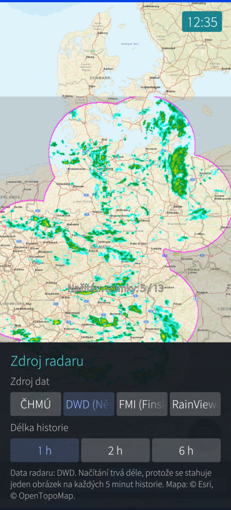
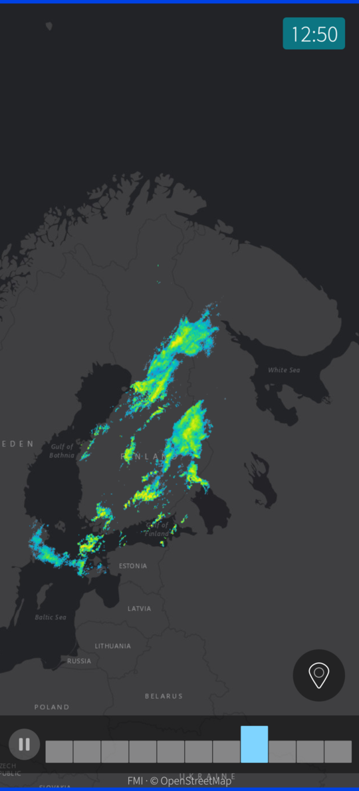
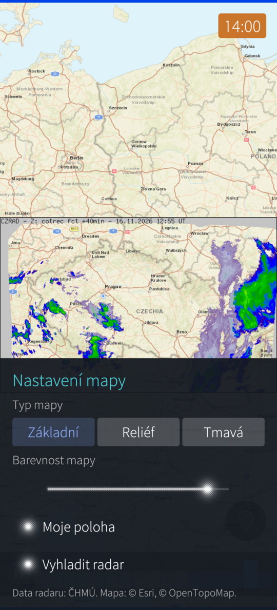

# Meteoradar (harbour-meteoradar)

Precipitation radar map for Sailfish OS 5.x (Jolla), inspired by the Meteor app.
It shows weather radar frames on a map with animation (past frames, nowcast where
the source provides it) and an optional lightning layer. The map is a custom
slippy map written in QML, no WebView.

Version: 1.0.0 (see `rpm/harbour-meteoradar.spec`). The UI is in Czech.

## Screenshots

| DWD source, "Radar source" sheet | FMI (Finland), dark base map | CHMI nowcast, "Map settings" sheet |
|---|---|---|
|  |  |  |

---

## 1. Features

- **Map** (`qml/components/SlippyMap.qml`): drag, pinch zoom, double tap to zoom in.
  Base map tiles are stored in a local database.
- **Radar layer** from four sources (see section 3), selectable in the settings.
- **Radar rectangle**: for sources with a fixed extent (CHMI, DWD, FMI) the view is
  centred on the radar rectangle and panning is limited so the rectangle never
  leaves the view. Zoom is free. Dragging inside the rectangle pans the map.
- **Timeline** at the bottom (`RadarTimeline.qml`): tap or drag to pick a frame,
  the ▶/❚❚ button starts the animation. Time badge top right (orange = forecast).
- **CHMI lightning** (CHMI source only, switch in the settings).
- **Base map**: Basic (ArcGIS World Street Map), Relief (OpenTopoMap),
  Dark (ArcGIS Canvas Dark Gray). Base map saturation is adjustable (0-100 %).
- **My position**: optional; the round button at the bottom right centres the map
  on the current position.
- **Pulley menus** (standard Silica behaviour):
  - drag down from the top edge outside the rectangle -> top menu,
  - drag up from the bottom edge outside the rectangle -> bottom menu.
  Items: **Map settings**, **Radar source**, **Refresh**.
- **Settings** (bottom sheet) with two sections, opened from the menu:
  - *Map settings*: map type, saturation, my position, smooth radar.
  - *Radar source*: source selection, lightning (CHMI only), history length (1 / 2 / 6 h).
- **Loading**: a large spinner in the middle of the display until the radar
  or its tiles are loaded. DWD and FMI frames appear progressively as they
  arrive ("Loading frames: x / y").
- **Auto refresh** every 3 minutes and when the app returns to the foreground.
- **Cover**: base map and the latest radar frame, Refresh action. RainViewer is not
  shown on the cover (see section 6).
- **Offline start**: the last observed CHMI frame is stored in dconf, so after a
  start without network at least that frame is shown.

---

## 2. Gestures

| Gesture | Where | Result |
|---|---|---|
| drag | inside the rectangle (RainViewer: between 15 % and 85 % of the height) | pan |
| pinch | inside the rectangle | zoom |
| double tap | inside the rectangle | zoom in one level |
| tap on the map | anywhere | closes the settings sheet |
| drag down from the top edge | outside the rectangle | top pulley menu |
| drag up from the bottom edge | outside the rectangle | bottom pulley menu |
| tap a frame in the timeline | bottom bar | select frame |
| drag in the timeline | bottom bar | scrub frames |

RainViewer has no rectangle, so panning and zooming work only in the middle band
of the map; the edges stay free for the menus.

---

## 3. Radar sources

Defined in `qml/js/radar.js` (`SOURCES`). The selected key is stored in
`cfg.radarSource`.

| Key | Name | Type | Coverage | Step | Notes |
|---|---|---|---|---|---|
| `chmi` | CHMI (Czech Hydrometeorological Institute) | JSON (`init` + `data`) | Czechia | 5 min | lightning, nowcast |
| `dwd` | DWD (Germany) | WMS `GetMap` | Germany (5.5-16.0 E; 46.5-55.5 N) | 5 min | no forecast |
| `fmi` | FMI (Finland) | WMS `GetMap` | Finland (15.3-42.7 E; 57.1-70.8 N) | 5 min | `Radar:radar_finland_cappi_dbzh` |
| `rv` | RainViewer | XYZ tiles | global (mainly Europe, Americas, parts of Asia and Australia) | ~10 min | latest frame only, see section 6 |

### 3.1 CHMI
- `https://data-provider.chmi.cz/api/map/init/radary.radary?client=mobile` lists the
  frames (`dataParts[].dataRef`, UTC `YYYYMMDDHHMM`) and `boundingBoxes[main]`.
- Frame: `.../api/data/pocasi/radary/<dataRef>` -> JSON `{"img": "data:image/png;base64,..."}`.
- Lightning: `.../api/data/pocasi/blesky/<dataRef>`.
- Observation = frames with time <= now, the rest is nowcast.

### 3.2 WMS (DWD, FMI)
- For every 5-minute step one `GetMap` is downloaded in **EPSG:3857**,
  `format=image/png`, `transparent=true`, `512x512`, `time=` in ISO 8601 (UTC).
- The image is placed over the rectangle of the given extent (lon/lat converted to
  Mercator), so it lines up with the base map.
- Verified (Playwright, 2026-11-16): DWD `dwd:Niederschlagsradar`,
  FMI `Radar:radar_finland_cappi_dbzh`.

### 3.3 RainViewer
- Frame list: `https://api.rainviewer.com/public/weather-maps.json`
  (`host`, `radar.past[{time, path}]`; `radar.nowcast` is empty on the free tier).
- Tiles: `host + path + "/256/{z}/{x}/{y}/2/1_1.png"`, zoom capped at 7
  (`R.RV_MAX_ZOOM`).
- History is limited: RainViewer offers at most 13 past frames (last 2 h). Only the
  frames inside the selected history length are shown.

### 3.4 Adding a source
1. Add an entry to `R.SOURCES` (`kind: "wms"` for WMS with `url`, `layer`, `bbox`).
2. Add the key to the `model` of the source buttons in `SettingsPanel.qml`.
3. If the source is neither WMS nor tiles, add a branch to `refresh()` in
   `qml/harbour-meteoradar.qml`.

---

## 4. Architecture

```
harbour-meteoradar.desktop        Sailjail: Internet; Location
rpm/harbour-meteoradar.spec       noarch RPM (Requires: sailfishsilica, qtgraphicaleffects, ...)
icons/gen.py                      launcher icon generator (PIL)
qml/harbour-meteoradar.qml        ApplicationWindow: settings (dconf), radar state,
                                  frame loading for all sources, timers, D-Bus quit
qml/js/radar.js                   sources (SOURCES), tile URLs, WMS/RainViewer URLs,
                                  time parsing, Mercator helpers, JSON GET
qml/js/tilecache.js               LocalStorage (SQLite) tile cache + image download
qml/components/SlippyMap.qml     map: base tiles, RainViewer overlay, radar image
                                  overlay (over bbox), lightning, gestures
qml/components/RadarTimeline.qml timeline
qml/components/MapButton.qml     round button over the map
qml/components/SettingsPanel.qml bottom sheet (modes "map" and "source")
qml/pages/MainPage.qml           main page: SilicaFlickable + PullDown/PushUp menus,
                                  SlippyMap, timeline, indicators
qml/cover/CoverPage.qml          cover: non-interactive SlippyMap + latest frame
docs/                             screenshots for this README
```

### 4.1 State and data flow
- `win.frames` is an array of `{t, ref, img}`. `img` is a data URI (CHMI, WMS);
  for RainViewer `img` is empty and `ref` holds the tile path instead.
- `win.current` is the index of the shown frame, `win.playing` drives the animation
  (Timer with `playInterval` = 430 ms; disabled for RainViewer).
- `refresh(force)` loads according to `cfg.radarSource`. Each refresh has a
  generation number (`refreshGen`); results of an older refresh (e.g. after
  switching the source) are discarded.
- `setRadarSource(src)` clears the frames and reloads.
- `win.loading` / `win.loadTotal` / `win.loadDone` drive the indicators.
- `win.errorText` is the only error message (red box at the top).

### 4.2 Map (`SlippyMap.qml`)
- Projection: Web Mercator. `centerLon/centerLat/zoom` live in `cfg`.
- `fitBbox()` runs once a rectangle is known (and after `bboxKey` changes): it sets the
  zoom so the rectangle fills the width and centres it.
- `clampCenter()` keeps the centre inside the rectangle; if the view is larger, the
  centre is locked.
- `pressInside`: on a press inside the rectangle (or inside the RainViewer middle
  band) the `SilicaFlickable` in `MainPage` stays still and the map pans itself.
  Elsewhere the flickable takes the drag and opens the pulley menu.
- Base tiles: `tileComponent`; loads go through `loadQueue` (3 tiles per timer
  tick), data from `TC` (DB) first, network otherwise.
- RainViewer overlay: a `Repeater` of tiles over the viewport; every tile reads
  from the DB (`TC.get`) or downloads (`TC.fetch`) and stores. The previous frame
  stays visible until the new tiles arrive. `tilesBusy` drives the big spinner.
- Radar image (CHMI, WMS): a single `Image` over `bbox`, `smooth` follows the
  "Smooth radar" setting.

### 4.3 Tile cache (`tilecache.js`)
- Database `meteoradar_tiles_v4` in LocalStorage (`openDatabaseSync`), table
  `tiles(key, data, ts)`. Values are data URLs (base64 PNG/JPEG).
- Limit `MAX_TILES = 1500`; trimming runs every 20th write (not on reads).
- Error pages (e.g. "Access blocked") are never stored: the PNG/JPEG signature is
  checked first.
- Bump the DB name (`_v4`) whenever the base map providers change, so old tiles are
  not reused.

---

## 5. Settings (dconf)

Path: `/apps/harbour-meteoradar/`

| Key | Default | Meaning |
|---|---|---|
| `centerLon`, `centerLat` | 15.5, 49.8 | map centre (saved on every pan) |
| `zoom` | 7 | map zoom |
| `mapType` | `voyager` | `voyager` / `relief` / `dark` |
| `saturation` | 1.0 | base map saturation (0 = greyscale) |
| `showPosition` | false | show and follow own position |
| `smoothRadar` | true | smooth the radar image |
| `radarOpacity` | 1.0 | radar opacity (currently always 1) |
| `radarSource` | `chmi` | `chmi` / `dwd` / `fmi` / `rv` |
| `lightning` | false | CHMI lightning (`chmi` only) |
| `historyMinutes` | 60 | history length: 60 / 120 / 360 |
| `playInterval` | 430 | ms per frame during animation |
| `cache` | "" | last observed CHMI frame (JSON) |

---

## 6. Known limitations

- **RainViewer rate limit:** 500 requests per minute (burst 300); above that the
  server returns HTTP 429. One frame is about 50 tiles, so an animation would
  exceed the limit. Therefore only the latest frame is shown and the animation is
  disabled for RainViewer. Switching to older frames downloads their tiles (they are
  then kept in the DB).
- **RainViewer zoom:** above level 7 the radar is only scaled up, no extra detail.
- **Cover:** RainViewer is not shown on the cover (saves requests).
- **WMS animation (DWD, FMI):** frames load progressively, the animation runs with
  the frames available so far.
- **Forecast:** CHMI only (nowcast). DWD, FMI and RainViewer (free tier) provide
  observations only.
- **Base map tiles:** Basic and Dark use ArcGIS without an API key; the providers may
  throttle requests.
- **Device logging:** QML `console.log` does not show up in the log on the phone.
  Debugging is done with a temporary on-screen label.
- **Silent QML errors:** a missing import (e.g. `Sailfish.Silica` in
  `SlippyMap.qml`) aborts a handler without any message. If a handler seems dead,
  check the imports first.
- **Testing:** the sources were verified with Playwright (HTTP 200 and PNG format).
  Look and gestures are verified on the device.

---

## 7. Build and deployment

There is no `build.sh` or `.pro` file. The build is a plain `rpmbuild` (noarch,
pure QML):

```
rpmbuild -bb rpm/harbour-meteoradar.spec \
    --define "_topdir $PWD/build" --define "_sourcedir $PWD/build/SOURCES"
```

with `build/SOURCES/harbour-meteoradar-<version>.tar.gz` containing
`harbour-meteoradar-<version>/{qml,icons,harbour-meteoradar.desktop,README.md}`.
On some hosts `--define "__spec_install_post %{nil}"` is needed (avoids
`linkdupes`/`selabel` failures). Output: `build/RPMS/noarch/`.

Install on the phone (developer mode, SSH):

```
scp -P 2233 build/RPMS/noarch/harbour-meteoradar-*.rpm defaultuser@<phone>:/tmp/
ssh -p 2233 defaultuser@<phone> 'devel-su rpm -U --force /tmp/harbour-meteoradar-*.rpm'
```

To restart the app from SSH, kill **only** this process (by its full command line
`sailfish-qml harbour-meteoradar`). Killing by the process name `sailfish-qml`
terminates every QML app on the phone.

Log check on the phone:
```
ssh -p 2233 defaultuser@<phone> 'grep -v -i "libselinux\|libGLES\|mali" /tmp/log | tail'
```

The version lives in `rpm/harbour-meteoradar.spec` (`Version` + `%changelog`).
Tag `vX.Y.Z` after testing on a device.

---

## 8. Licence and data sources

- Radar data: CHMI (open data), DWD (Deutscher Wetterdienst), FMI (Finnish
  Meteorological Institute), RainViewer (free API, subject to RainViewer terms).
- Base maps: (c) Esri (ArcGIS), (c) OpenTopoMap (CC-BY-SA), (c) OpenStreetMap
  contributors.
- Code: MIT (see the spec file).
